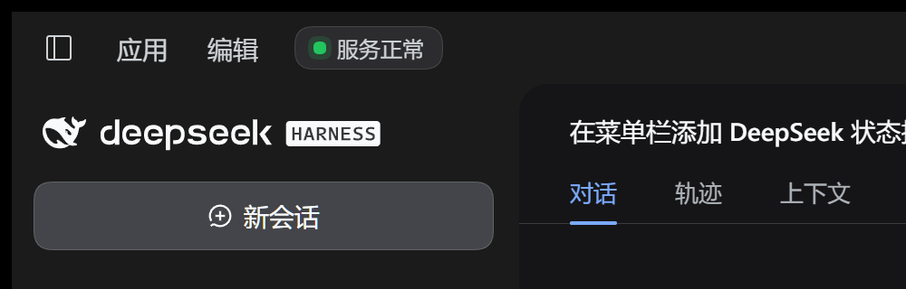
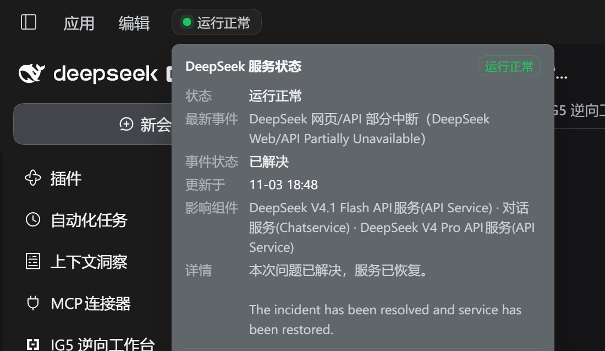

# dsh-deepseek-status-pill

把 **DeepSeek 服务状态**放进 DeepSeek Harness Desktop 窗口顶栏，紧挨「应用」「编辑」菜单：
一个圆角胶囊、一盏指示灯、一句状态。正常绿灯，故障或读取失败黄灯；鼠标悬停或键盘聚焦展开
详情面板，显示最新故障、影响组件、数据来源与错误信息。

Adds a **DeepSeek service status pill** to the DeepSeek Harness Desktop caption, right after the
Desktop-owned menus: a rounded box with one indicator light and the current state, plus a detail
panel on hover or focus.





## 快速安装

发布并收录进社区目录后，用户在应用内即可一键安装：

1. **插件市场（Desktop）**：`插件` 页 → `插件市场`（dshmarket）→ 搜索 `DeepSeek 状态` → 安装。
2. **官方 Discover**：`插件` → `发现` → `索引源` 添加
   `https://cdn.jsdelivr.net/npm/dsh-plugin-catalog/index.json`，再搜索同一张卡片安装。
3. **命令行**（其他 profile）：`dsh plugin --profile <profile> add dsh-deepseek-status-pill`
4. **本地开发**：用 Plugin Manager 安装工作区目录——
   `plugin_manager { action: "install_bundle", target: "<workspace>/dsh-deepseek-status-pill" }`

> 尚未进入社区目录时，可以先自建一个 format 1 索引并在 `发现 → 索引源` 里添加它，同样是一键安装；
> 模板见 [`distribution/index.example.json`](distribution/index.example.json)，完整步骤见
> [PUBLISHING.md](PUBLISHING.md)。

> Desktop 的 profile 由应用管理，请使用应用内插件页安装；用 CLI 装进 `profiles/web` 不会出现在
> Desktop。安装/更新后如需重新加载 Host 半，先移除再安装（或重启应用）。

支持环境：

| 环境 | 表现 |
|---|---|
| DSH Desktop（Windows），`dsh >= 0.2.1-rc.5` | 顶栏胶囊 + 悬停/聚焦详情面板 |
| macOS Desktop | 无 Windows 顶栏标记，插件静默不渲染（不报错） |
| 普通 `dsh web` 浏览器页面 | 同上，不渲染 |

## 状态与灯色

| 胶囊状态 | 指示灯 | 胶囊文字 | 判定 |
|---|---|---|---|
| 正常 | 绿色 | 服务正常 | Atom 最新条目 `Status:` 为 `resolved`（或 feed 为空） |
| 故障 | 黄色（呼吸光晕） | 服务异常 | 最新条目仍为 `investigating` / `identified` / `monitoring` / `scheduled` 等未结束状态 |
| 读取失败 | 黄色（呼吸光晕） | 状态获取失败 | Host 拉取/解析失败或页面读不到 Host 路由 |
| 首次检查 | 灰色 | 检查中… | 首个快照尚未返回 |

`Status:` 字段缺失时，若条目更新时间在 12 小时内按「故障」处理，否则按「正常」处理——宁可短暂
偏黄，也不把未结束的故障显示成绿色。

## 交互与位置

- 悬停胶囊、或键盘 `Tab` 聚焦胶囊即展开详情；指针移出或失焦后收起，`Esc` 立即关闭。
- 胶囊与面板都在顶栏条内声明 `-webkit-app-region: no-drag`，不阻塞窗口拖动；面板 `top` 与顶栏
  高度无缝衔接，指针从胶囊移到面板不会中断。
- 位置锚定 Desktop preload 的 `[data-windows-menu]` 宿主右边缘 +10px，随语言切换、侧栏收起、
  窗口缩放重新定位；右侧空间不足时自动隐藏，不覆盖宿主控件。
- 样式只引用 `--dsw-alias-*` 主题令牌，明暗主题跟随宿主；`prefers-reduced-motion` 关闭呼吸光晕。

## 数据来源

```
GET https://status.deepseek.com/feed.atom   ← Host 拉取并解析（Atom）
        │
        ▼
GET /deepseek-status/feed                    ← 同源路由，Host 半缓存 45s
        │
        ▼
顶栏胶囊 + 悬停/聚焦详情面板
```

- **只读 Atom 订阅**：不抓状态页 HTML、不轮询私有接口。
- 解析 `<entry>` 的 `title` / `updated` / `id` / `link` / `summary`（HTML → 纯文本），从 summary 读
  `Status:` 与 `Affected components:`，其余文本作为「详情」。
- 只认最新一条条目：已解决即服务已恢复。
- 上游请求 10s 超时、响应体上限 512 KiB；Host 45s 快照缓存 + single-flight；失败保留上次成功快照，
  响应携带 `state: "error"`、`error.message` 与 `lastSuccessAt`。
- 浏览器半每 60s 轮询（出错后 15s 重试），页面不可见时跳过，重新可见立即刷新。

## 安全

路由由 `dsh-host-webserver` 承载，该服务器自身不带来源策略，校验在插件内完成。请求必须同时满足：

1. 携带自定义头 `x-dsh-deepseek-status: 1`（非简单头，跨站请求会触发本服务器不回答的预检）；
2. 来自本来源：存在 `Origin` 时其 host 必须等于 `Host`；同源 GET 浏览器不发送 `Origin`，此时改看
   `Sec-Fetch-Site`（`same-origin` / `none` 放行），并由连接层已强制、`SameSite=Strict` 的
   `dsh-auth-*` 会话 Cookie 兜底。

其余一律 403；非 GET/HEAD 返回 405。响应 `Cache-Control: no-store`，服务器只绑定 `127.0.0.1`。

## 结构

```
dsh-deepseek-status-pill/
├─ package.json          dsh.bundle.patch + dsh.client（web / immediately / inject ui-layout）
├─ cordis.patch.yml      insert 一行：id=deepseek-status-pill
├─ index.js              Host half：Atom 拉取 + 解析 + 缓存 + /deepseek-status/feed 路由
├─ client.js             浏览器 half：顶栏胶囊、指示灯、悬停/聚焦详情面板
├─ icon.svg              Plugin Manager 卡片图标
├─ assets/               商店截图与 180px 图标（catalog icon）
├─ screenshots.json      商店截图清单（读自本仓库）
├─ locale/{zh,en}.json   插件标题与描述
├─ scripts/check-publish.mjs  发布前占位符/文件自检（prepack）
├─ distribution/         目录条目模板与可选的 npm 发布 CI
├─ README.md / CHANGELOG.md / LICENSE / PUBLISHING.md
```

浏览器半不 import 任何 Harness Client 包，也不依赖 React；包本身没有任何运行时依赖。

## 开发与自检

```sh
node --check index.js && node --check client.js   # 语法
npm pack --dry-run                                 # 包内容（prepack 会检查占位符与必需文件）
```

本地生效方式见「快速安装」第 4 条；修改已安装插件后需先移除再安装（或重启应用）以加载新的
Host/Client 模块。
